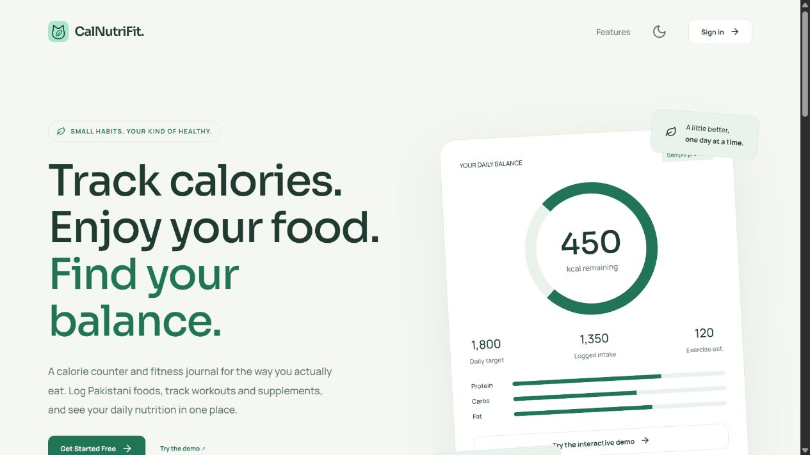
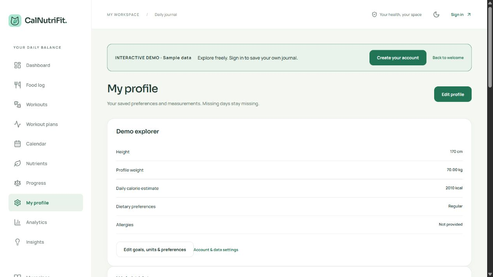
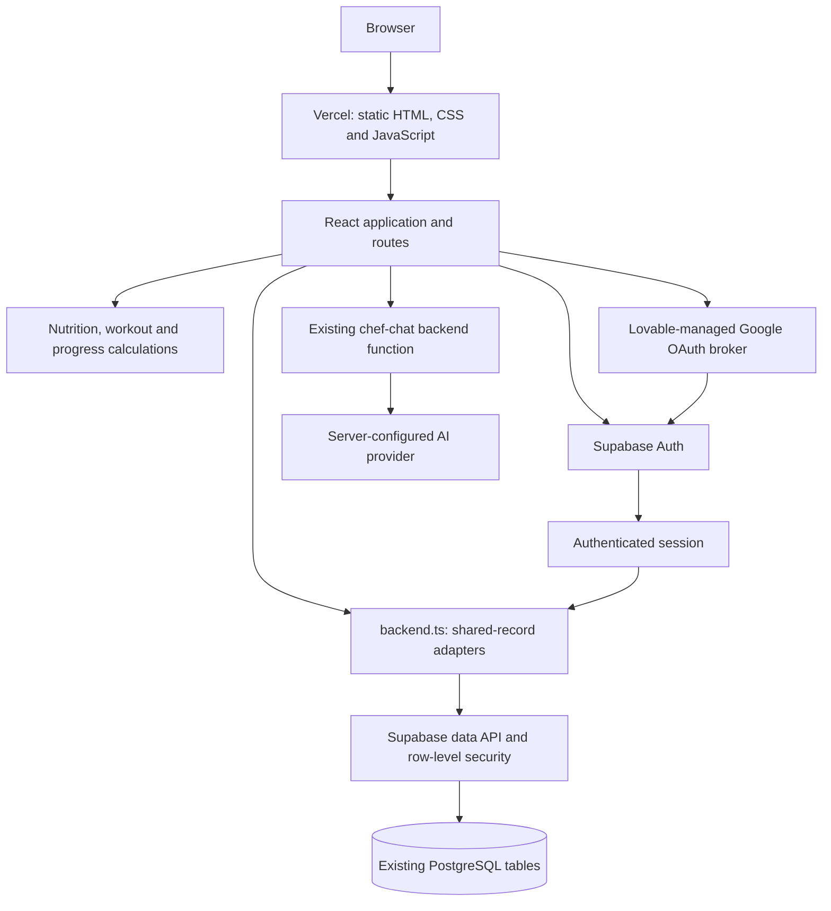

<div align="center">
  
  <h1>CalNutriFit</h1>
  <p><strong>Food you love. Progress you can follow.</strong></p>
  <p>A nutrition and fitness journal for everyday meals, movement and measurable progress.</p>
</div>


**[Live app](https://calnutrifit.vercel.app/)** · [Run locally](#getting-started) · [Architecture](#architecture) · [Verification & limits](#verification-and-current-limits)

## Overview

CalNutriFit brings meals, supplements, workouts and body measurements into one daily journal. Its food catalog includes Pakistani dishes alongside other everyday foods, with custom label entry for products the catalog does not cover.

Food and supplement intake feed the same daily balance. Exercise calories remain visible as estimates; nutrient views distinguish **unknown values from confirmed zeroes**. Historical records retain their logged nutrition and workout estimates.

The frontend builds on the existing **Nutrio Pulse Tracker** backend. Both apps share accounts and user-owned records. Editing a shared record can affect both applications.

**Project status:** deployed and actively developed. The [upgrade report](docs/UPGRADE-2026-10-20.md) records tested behavior and remaining work. This repository does not claim complete production readiness, verified nutrition for every catalog item, or medical accuracy.

## Screenshots

Actual application captures. The profile image uses the explicitly labeled demo workspace, not a person's health records.

### Public landing page



<details>
<summary>View the profile and journal navigation</summary>



</details>

## Features

| Area | Implemented behavior |
| --- | --- |
| Food journal | Breakfast, lunch, dinner and snacks; searchable food catalog, custom foods, portions and dated entries. |
| Daily balance | Combined food and supplement intake, exercise estimates, net calories and shared macro totals. |
| Micronutrients | Optional label values for 13 vitamins and 11 minerals, food/supplement breakdowns, missing-data indicators and adult reference comparisons. |
| Supplements | Separate saved products and actual doses; editable product details, daily/weekly schedules, skipped dates and intake history. |
| Workouts | Local animated guides, daily completion tracking, plans, custom activities and editable MET-based calorie estimates. |
| Progress | Editable profile, kg/lb weight entry, dated weight charts, body measurements and optional private notes. |
| Analytics | Date-range summaries, nutrient history, deterministic observations, CSV downloads and journal JSON export. |
| Recipes | Manual recipes, saved ingredients, shopping lists and AI-assisted suggestions through the existing server function. |
| Accounts | Email/password sign-in, provider-managed verification/recovery flows, Lovable-managed Google sign-in and provider-aware password controls. |
| Interface | Responsive layouts, light/dark themes, accessible dialog primitives and a labeled demo that does not persist journal edits. |

Nutrition references have a limited adult scope; pregnancy, lactation and individual medical requirements need separate guidance. Saved supplement schedules do not count as consumption. AI recipe nutrition is calculated from supported catalog ingredients, not accepted as invented model-generated numbers.

## Tech stack

| Layer | Technologies and purpose |
| --- | --- |
| Application | React 18, React DOM, strict TypeScript, React Router 7 |
| UI | Custom CSS, Radix Dialog, Lucide icons, Recharts |
| Validation | Zod schemas plus domain-specific calculation and input checks |
| Data & authentication | Supabase JavaScript SDK; existing PostgreSQL tables, row-level security and Supabase Auth |
| Google sign-in | `@lovable.dev/cloud-auth-js` with the existing Nutrio OAuth broker |
| AI integration | Existing `chef-chat` backend function, Fetch API and a bounded streaming-response reader |
| Build & testing | Vite 8, React Vite plugin, Vitest 5, Node.js 24 and npm |
| Delivery | Vercel static hosting; GitHub Actions quality-check workflow |
| Assets | Local SVG/GIF workout guides; Google Fonts for Manrope and Sora |

Dependency ranges live in [package.json](package.json); reproducible resolved versions live in [package-lock.json](package-lock.json). No Express server, ORM or separate Node production API is included in this checkout.

## Architecture



The public landing page is prerendered at build time. Private views run in the browser and load the signed-in user's journal through `src/backend.ts`.

Records are stored in `food_entries`, `supplement_entries`, `workout_entries`, `weight_logs`, `fitness_goals`, `recipes` and `user_settings`. Nutrition snapshots and CalNutriFit-specific metadata use existing JSON fields. There is no database replacement or destructive migration in this upgrade.

Individual row edits and deletions compare the values originally loaded by the journal. Conflicting changes are rejected. **A save spanning multiple rows or tables is still not a single transaction.**

## Getting started

### 1. Install and start the demo

Prerequisites: Git, Node.js **24** and npm. Node 24 matches the repository's CI configuration.

```bash
git clone https://github.com/nimraweb3/calNutriFit.git
cd calNutriFit
npm ci
npm run dev
```

Open the local address printed by Vite, normally `http://127.0.0.1:5173`, and choose **Try the demo**. No backend credentials are required to explore the sample workspace. Demo edits do not become saved account records.

### 2. Configure authenticated storage

Copy `.env.example` to `.env.local`:

```bash
# macOS / Linux
cp .env.example .env.local
```

```powershell
# PowerShell
Copy-Item .env.example .env.local
```

Obtain the authorized project's **public** URL and browser key from its owner. Fill these names locally; do not paste private credentials into source files:

| Variable | Required for | Notes |
| --- | --- | --- |
| `VITE_SUPABASE_URL` | Account-backed features | Existing compatible Supabase/Lovable backend URL. |
| `VITE_SUPABASE_PUBLISHABLE_KEY` | Account-backed features | Preferred browser-public key; takes precedence when supplied. |
| `VITE_SUPABASE_ANON_KEY` | Alternative to the key above | Supported fallback; this is the name shown in `.env.example`. |

Only one of the two key variables is needed. Restart the dev server after changing environment files. Vite embeds `VITE_` values in browser assets; they are **not secret storage**.

This repository does not provision a new backend automatically. A new Supabase project needs compatible tables, ownership policies and authentication configuration first. See [operations](docs/OPERATIONS.md) for the shared schema and reference migration location.

**Google authentication is project-specific:** the code uses Nutrio's Lovable-managed broker and an explicit production callback. Starting that flow locally returns to production. Forks need their own authorized broker/callback configuration; changing only the public database URL will not complete that setup. Preserve the shared Nutrio configuration when working on the existing project.

### 3. Check and build

```bash
npm test
npm run build
```

`npm test` runs the source regression suites. `npm run build` runs TypeScript checks, creates `dist/` with Vite, and prerenders the public landing page.

<details>
<summary>Deployment and integration testing</summary>

Vercel configuration is in [vercel.json](vercel.json): Vite framework, `npm run build`, output `dist`, route rewrites and response headers. Add only the public frontend environment variables to a deployment.

The existing site has been deployed through compiled-output uploads; a GitHub push is not proof of a production deployment. See [deployment history](DEPLOYMENT.md) and the latest [upgrade report](docs/UPGRADE-2026-10-20.md).

Integration scripts under `scripts/` can create, edit and remove records. Run mutation tests only with dedicated synthetic accounts and the ignored local credential files they expect. Never substitute a personal account or run them merely to preview the UI. Normal `npm test` does not require those credentials.

The GitHub Actions workflow runs `npm ci`, tests, build and `npm audit --audit-level=high` when the workflow is present on the pushed branch. No CI success badge is displayed without a verified run.

</details>

## How to use

1. **Explore or sign in.** Try the demo first, or use your account to save a journal.
2. **Set your starting point.** Complete or skip onboarding. Add measurements and preferences when you want calculated targets.
3. **Log a meal.** Choose a date and meal, find a food or enter its label, then confirm the portion.
4. **Record supplements separately.** Save reusable products, then log the doses actually taken. Scheduled or skipped doses add no nutrients.
5. **Record movement.** Tick off a dated workout or add a custom activity. Review the duration, body weight and estimated calories.
6. **Review progress.** Open Nutrients, Progress or Analytics. Missing measurements stay missing; use exports when you need a copy.
7. **Manage account settings.** Review available provider-specific controls and export your journal. Account deletion is not yet implemented.

## Project structure

```text
src/
  main.tsx                 Application shell, routing and journal updates
  backend.ts               Auth client, shared-table adapters and conditional saves
  engine.ts                Data types, profile validation and core calculations
  daily-balance.ts          Shared intake / exercise totals
  AuthPanel.tsx             Sign-in, verification and recovery UI
  AccountSecurity.tsx       Provider-aware password and session controls
  NutritionView.tsx         Daily nutrient coverage and references
  NutrientTrends.tsx        Nutrient history and observations
  SupplementProducts.tsx   Saved products and schedules
  SupplementHistory.tsx    Actual intake history
  ProfileView.tsx           Profile and weight progress
  ProfileExtras.tsx         Body measurements and optional notes
  RecipeStudio.tsx          Recipes and shopping lists
  recipe-ai.ts              Validated AI recipe integration
  catalog.ts / legacy/      Local catalogs and shared-record compatibility
  *.test.ts                Regression tests
public/                    Icons, workout assets, SEO and hosting files
scripts/                   Prerendering, asset generation and integration checks
docs/                      Operations, audit evidence and screenshots
.github/workflows/         Automated quality checks
```

## Security and data handling

- User-scoped queries work with the existing backend's row-level security. Hiding a UI element is not authorization.
- The frontend rejects recognized secret/service-role key configurations. Provider credentials belong on the server.
- Auth sessions persist through the Supabase SDK. Journal records are fetched from the database; local browser storage also holds the theme and auth session, not a primary journal database.
- Conditional updates/deletes reject stale record changes; settings also use conflict checks. These checks do not guarantee atomic multi-table saves.
- Password changes for email accounts require current-password reauthentication. “Sign out other sessions” revokes refresh sessions; existing access tokens may remain valid until expiry.
- AI response parsing has client-side size/time limits and schema validation. Server-side authorization, quotas and input controls remain separate work.
- Vercel sends framing, content-type and other defensive headers. Private-route `noindex` is an indexing instruction, not access control.
- Screenshots use public or demo content. Do not commit health records, exports, tokens, `.env.local`, `.env.demo` or `.env.audit-test`.

## Verification and current limits

The latest documented code verification on **20 October 2026** recorded **76 passing tests**, a successful production build and live synthetic-account checks for persistence and stale edit/delete rejection across six record types. This is a dated result, not a coverage percentage or a claim about every browser/device.

Remaining work includes:

- Atomic, retry-safe multi-record saves and wider simultaneous-device testing.
- Account deletion and a documented shared-account privacy/retention process.
- Deployment of server-side AI authorization, limits and quotas.
- Verified regional nutrition lookup and pregnancy/lactation-specific nutrient references.
- AI workout interpretation, reminders and secure progress-photo storage.
- Broader accessibility, performance and recovery testing.

Catalog estimates and user-entered labels are not independently verified medical data. See the [production audit](docs/PRODUCTION-AUDIT.md) and [latest upgrade report](docs/UPGRADE-2026-10-20.md) for evidence, scope and limitations.

## Contributing

Open an issue describing the problem and expected behavior before a substantial change. For code changes:

1. Create a focused branch and keep shared Nutrio compatibility in mind.
2. Add meaningful regression coverage for changed behavior.
3. Run `npm test` and `npm run build`.
4. Explain the user-visible change, validation and any schema or auth impact in the pull request.
5. Use synthetic data in examples and screenshots. Do not commit credentials or personal records.

Do not apply migrations to the shared production backend without a reviewed rollout plan and authorized access.

## License and provenance

No project-level `LICENSE` file is currently included. No open-source license grant is asserted; obtain permission from the repository owner before reuse. Dependencies retain their respective licenses.

The shared-backend/catalog reference is [Nutrio Pulse Tracker](https://github.com/nimraweb3/nutrio-pulse-tracker), inspected at commit `df1441c2ceb4d2eab2cc1dc96cfb6a88da3d8c83`. CalNutriFit retains its own frontend branding and interface.
